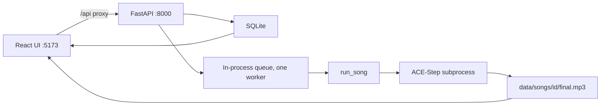

# SongCraft

SongCraft is a local web app that turns a text prompt into a short song with vocals, and keeps the result after you close the tab.

## Demo

<!-- TODO(samar): add a screenshot or GIF of the prompt form and a song card -->


| Prompt | Audio |
| --- | --- |
| <!-- TODO(samar): exact prompt for sample 1 --> | [sample 1](assets/sample-1.mp3) |
| <!-- TODO(samar): exact prompt for sample 2 --> | [sample 2](assets/sample-2.mp3) |
| <!-- TODO(samar): exact prompt for sample 3 --> | [sample 3](assets/sample-3.mp3) |

Put the image and the mp3 files in `assets/`. They are not in the repo yet.

## What it does

- You submit a prompt (3–500 characters) and a duration. The form slider runs from 10 to 30 seconds and starts at 30.
- The API returns immediately with a song id. The card polls until the song is finished or has failed.
- You can close the tab. The song list is loaded from the server the next time you open the app.
- A finished song shows the lyrics, tempo when ACE-Step returned one, and an audio player for the final mix.
- You can delete a song. That removes the database row and `data/songs/{id}/`.
- A failed song shows one error sentence. The client does not receive a stack trace.

## How it works



The UI talks only to `/api`. Vite proxies that to `127.0.0.1:8000`. `POST /api/songs` stores a `queued` row and returns 202. A single background thread runs one song at a time.

On the default path the worker does not call the lyrics model, the beat tracker, or the mixer. It starts `.venv-acestep` and runs `backend/songcraft/pipeline/acestep_worker.py` on the same machine. That process loads ACE-Step 1.5 from `ace-step/checkpoints`, asks the 0.6B planner for English lyrics and a caption, then renders the mix with `acestep-v15-turbo`. The mp3 is saved as `data/songs/{id}/final.mp3`. The API stores the lyrics, BPM, and the duration that was actually sent to ACE-Step.

Requests shorter than 10 seconds are raised to 10 before that call. The API still clamps incoming durations to `SONGCRAFT_MIN_DURATION_SECONDS`–`SONGCRAFT_MAX_DURATION_SECONDS` (5–30 by default).

If `SONGCRAFT_MUSIC_GENERATOR=musicgen`, the older path runs instead: MusicGen writes an instrumental, librosa finds beats, the lyrics model writes lines, a vocal step writes one clip per line, and pydub mixes them. That path can also show an instrumental player. ACE-Step does not.

## Key design decisions

- Songs run on a background queue, and the browser polls `GET /api/songs/{id}` every 2 seconds until the status is `completed` or `failed`. The request that creates a song does not wait for the model.
- SQLite is the source of truth. Audio files live under `data/songs/{id}/`. Restarting the server does not delete finished songs.
- A song left in a running status at startup is marked failed with "Interrupted by server restart". A song still `queued` is put back on the queue.
- Each pipeline slot is selected by name in config (`acestep`, `musicgen`, `instruct`, `gpt2`, `melody`, `gtts`, `pydub`, `librosa`, or `fake`). Tests use the fakes and never download weights.
- MusicGen and the Qwen lyrics model keep their weights on the API process after the first use. ACE-Step does not: each song starts a new process and loads the weights again.
- Each completed older-pipeline step stores its duration in `step_timings`. The ACE-Step path records only `generating_music`.

## Tech stack

| | |
| --- | --- |
| Backend | Python, FastAPI, SQLModel, SQLite |
| Frontend | React 19, TypeScript, Vite 6, TanStack Query |
| Song model | ACE-Step 1.5, turbo decoder plus `acestep-5Hz-lm-0.6B`, run locally in `.venv-acestep` |
| Optional models | MusicGen small, Qwen2.5-1.5B-Instruct, GPT-2, gTTS |
| Storage | `data/songcraft.db` and `data/songs/` |
| Tests | pytest for the API and pipeline, Vitest for the polling hook |

## Getting started

Prerequisites: Python for the API, and Python `>=3.11,<3.13` for the ACE-Step checkout (`ace-step/pyproject.toml`). Node and npm for the frontend. Versions are not pinned in this repo.

<!-- TODO(samar): GPU you have tested, and whether CPU-only generation works -->

ACE-Step is configured here with CUDA, INT8 weights, and CPU offload (`backend/songcraft/pipeline/acestep_worker.py`). `SONGCRAFT_DEVICE=auto` is passed to that process as `cuda`.

There is no install target in the Makefile. The API expects a virtualenv at `.venv-acestep` and a checkout at `ace-step/` unless you set `SONGCRAFT_ACESTEP_PYTHON` and `SONGCRAFT_ACESTEP_ROOT`. The first real song downloads `ACE-Step/Ace-Step1.5` and `ACE-Step/acestep-5Hz-lm-0.6B` into `ace-step/checkpoints`. Both directories are gitignored.

```powershell
python -m venv .venv
.venv\Scripts\python -m pip install -r backend\requirements.txt
copy .env.example .env
cd frontend
npm install
```

Create `.venv-acestep` from Python 3.11 or 3.12 and install the `ace-step` checkout into it, including its CUDA PyTorch build. That install is not scripted in this repo.

| Variable | Default in `.env.example` | Role |
| --- | --- | --- |
| `SONGCRAFT_DATABASE_URL` | `sqlite:///./data/songcraft.db` | SQLite file |
| `SONGCRAFT_DATA_DIR` | `./data` | Database parent and `songs/` audio |
| `SONGCRAFT_DEVICE` | `auto` | `auto`, `cuda`, `mps`, or `cpu` |
| `SONGCRAFT_MIN_DURATION_SECONDS` | `5` | Lower clamp for the API |
| `SONGCRAFT_MAX_DURATION_SECONDS` | `30` | Upper clamp for the API |
| `SONGCRAFT_CORS_ORIGINS` | `http://localhost:5173` | Comma-separated origins |
| `SONGCRAFT_MUSIC_GENERATOR` | `acestep` | `acestep`, `musicgen`, or `fake` |
| `SONGCRAFT_LYRICS_GENERATOR` | `instruct` | Used only on the MusicGen path |
| `SONGCRAFT_VOCAL_SYNTHESIZER` | `melody` | Used only on the MusicGen path |
| `SONGCRAFT_MIXER` | `pydub` | Used only on the MusicGen path |
| `SONGCRAFT_BEAT_ANALYZER` | `librosa` | Used only on the MusicGen path |
| `SONGCRAFT_MUSIC_MODEL` | `facebook/musicgen-small` | MusicGen model id |
| `SONGCRAFT_LYRICS_MODEL` | `Qwen/Qwen2.5-1.5B-Instruct` | Instruct lyrics model id |
| `SONGCRAFT_JOB_QUEUE` | `inprocess` | `inprocess` or `inline` |

`SONGCRAFT_ACESTEP_PYTHON` and `SONGCRAFT_ACESTEP_ROOT` are read by the app but are not in `.env.example`. Empty means `.venv-acestep/Scripts/python.exe` and `./ace-step`.

Set every generator to `fake` to run the API with no model downloads.

From the repo root, the Makefile runs:

```makefile
python -m uvicorn songcraft.main:app --reload --app-dir backend --host 127.0.0.1 --port 8000
cd frontend && npm run dev
python -m pytest
cd frontend && npm test
```

```text
make backend
make frontend
make test
```

Open `http://localhost:5173`.

## Results

<!-- TODO(samar): one sentence on how these numbers were measured -->

| | |
| --- | --- |
| Generation time per song | <!-- TODO(samar): add generation time per song --> |
| Hardware | <!-- TODO(samar): add hardware used --> |
| Rough cost per song | <!-- TODO(samar): add rough cost per song --> |
| Listener ratings | <!-- TODO(samar): add listener ratings --> |
| Number of prompts | <!-- TODO(samar): add number of prompts --> |

## Limitations

- There is no authentication. Anyone who can reach the API can create, read, and delete songs.
- The queue is one thread in the API process. A second song waits.
- The worker thread is a daemon. A song that is mid-generation when the process stops is marked failed and is not resumed.
- ACE-Step loads from disk on every song.
- The progress list still shows beat analysis, lyric writing, vocal synthesis, and mixing. On the ACE-Step path the status stays on `generating_music` until the subprocess exits, then the song is `completed`.
- ACE-Step does not write `instrumental.wav`, so that player stays hidden.
- The planner can ignore parts of the prompt. The lyrics you see are whatever `create_sample` returned.
- The MusicGen path needs ffmpeg on `PATH`, or `ffmpeg/ffmpeg.exe` and `ffmpeg/ffprobe.exe` in the repo, because pydub exports the mix.

## Roadmap

- Show one "Generating" step while ACE-Step is running, instead of the older five-step list.
- Keep the ACE-Step process alive between songs so weights are not loaded every time.
- Add a Make or script target for the `.venv-acestep` install and the weight download.
- Let the form pass lyrics through, instead of always using the planner's lyrics.
- Add a project license file.

## Credits and licenses

ACE-Step 1.5 is included as a local checkout under `ace-step/`. Its code is MIT. See `ace-step/LICENSE`.

`audiocraft/` is Meta's AudioCraft tree. MusicGen is optional and is not the default generator. The `facebook/musicgen-small` weights are CC-BY-NC 4.0, so that path is non-commercial.

`diffsinger/` and `legacy/` are still in the tree. The running app does not call them.

<!-- TODO(samar): choose a license for SongCraft. There is no LICENSE file. -->
